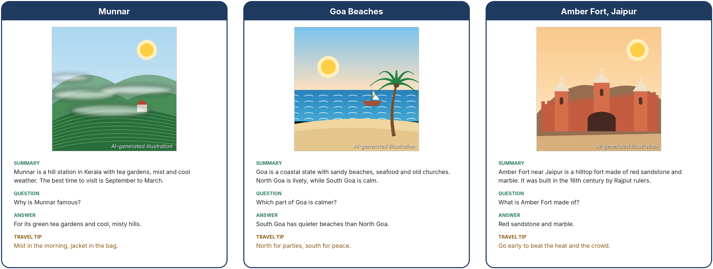
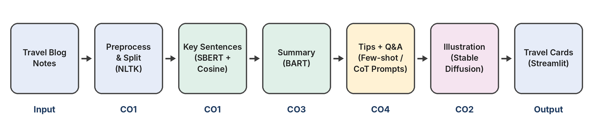

# TripSketch

**AI-powered illustrated travel guide card generator from travel blogs.**

Upload travel notes (a `.txt` file) and TripSketch makes one card per destination with a short summary, a question and answer, a travel tip and an AI-generated picture.



## Pipeline

| Step | Module | Technique | Course outcome |
|---|---|---|---|
| 1 | `preprocess.py` | NLTK cleaning, split into destinations | CO1 |
| 2 | `keysentences.py` | SBERT embeddings + cosine similarity | CO1 |
| 3 | `summarise.py`, `evaluate.py` | BART summary, ROUGE score | CO3 |
| 4 | `prompts.py`, `llm.py` | Few-shot and chain-of-thought prompts | CO4 |
| 5 | `illustrate.py` | Stable Diffusion + watermark | CO2 |
| 6 | `app.py` | Streamlit web page | - |



## Folder structure

```
tripsketch-genai-travel-cards/
├── app.py                  # Streamlit interface
├── src/tripsketch/
│   ├── config.py           # model names and constants
│   ├── preprocess.py
│   ├── keysentences.py
│   ├── summarise.py
│   ├── evaluate.py
│   ├── prompts.py
│   ├── llm.py
│   └── illustrate.py
├── sample_data/travel_notes.txt
├── tests/test_preprocess.py
├── docs/                   # project report (PDF, DOCX) and figures
├── requirements.txt
├── .env.example
└── LICENSE
```

## Setup

```bash
git clone https://github.com/<your-username>/tripsketch-genai-travel-cards.git
cd tripsketch-genai-travel-cards
python -m venv .venv
source .venv/bin/activate        # Windows: .venv\Scripts\activate
pip install -r requirements.txt
export OPENAI_API_KEY=your-key   # Windows PowerShell: $env:OPENAI_API_KEY="your-key"
```

## Run

```bash
streamlit run app.py
```

Upload `sample_data/travel_notes.txt` and click **Generate cards**. For your own notes: one block per destination, blocks separated by a blank line, destination name on the first line.

Image generation is slow on CPU. A GPU (or Google Colab) is recommended. Model files need about 15 GB of disk space.

## Tests

```bash
pytest
```

## Ethics

Every picture carries an "AI-generated illustration" watermark. Pictures are imagined illustrations, not real photographs. Always verify timings, prices and safety information from official sources.
